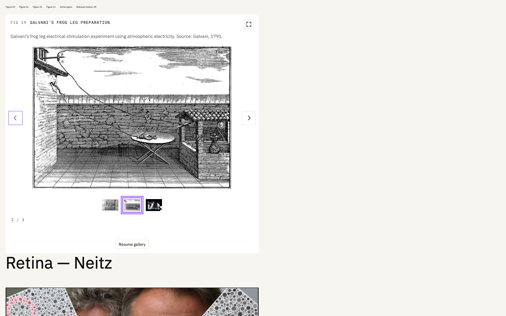
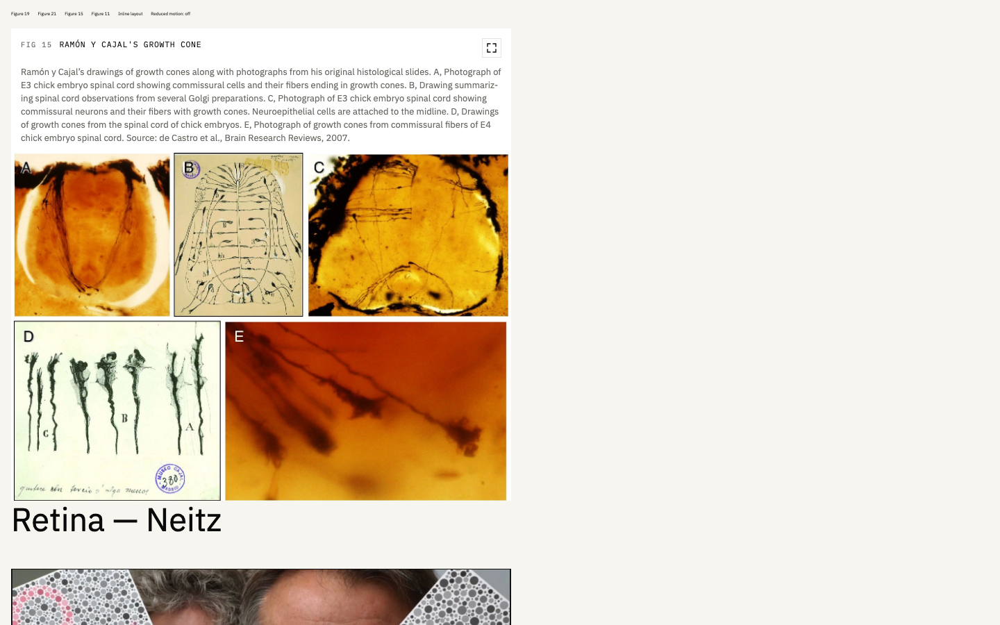
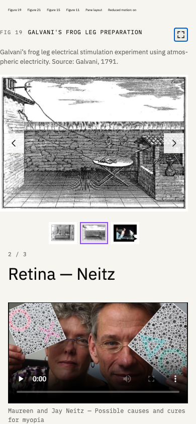
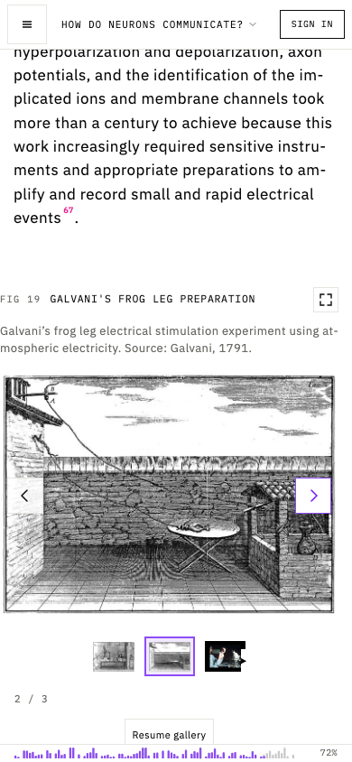
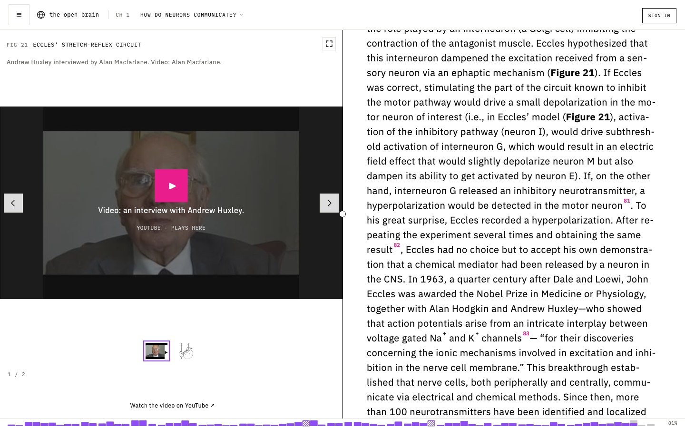

# G2 delivery — figures, galleries and media

Implementation branch: `antonmogul/Figures-media-followups`, based on main `3f1bcd8171632503ac5bea8c822ea67d3c889940` (PR #143). [PR #149](https://github.com/antonmogul/theopenbrain.org/pull/149); validated implementation commit `9f68e0802503e30edb369d9e522baf4602888cfa`. The delivery receipt records the final head including this report link. No merge, deployment, live Supabase write or email was performed.

## Research: code, content and deployment

Production's last coordinator-verified deployment was PR #140; this run does not establish a newer Railway SHA. The reports below reproduce on the live demo and remain present in current main/configuration, so these are additional changes rather than duplicate PR #143 repairs.

| Request | Confirmed cause                                                                                                                                                     | Change                                                                                                                                                                                                                                                    |
| ------- | ------------------------------------------------------------------------------------------------------------------------------------------------------------------- | --------------------------------------------------------------------------------------------------------------------------------------------------------------------------------------------------------------------------------------------------------- |
| R04     | Main uses 10 seconds and dot controls.                                                                                                                              | 15 seconds, square image thumbnails, selected state, scrolling on narrow panes, explicit pause/resume; existing hover/focus/manual/hidden/offscreen pauses retained. Player-first galleries never rotate away.                                            |
| R08     | The exact validated-in-primates paragraph owns Fig11, not Fig10; its live trigger has no room flag.                                                                 | Guarded migration adds one screen below Fig11. Existing round-3 Fig10 room supplies space before this paragraph. No SectionComp or global spacing changes.                                                                                                |
| R11     | A 62ch cap and the heading/expand flex row constrain legends.                                                                                                       | Caption spans the full toolbar width below the heading and expand button; long-caption scrolling remains.                                                                                                                                                 |
| R13     | The shell uses a fixed figure caption; Fig19's two Galvani plates have no individual caption.                                                                       | One legend follows the selected index across pane/modal, manual/reverse/automatic steps. Migration separates the existing authored Galvani legend into friction-machine and atmospheric-electricity captions, preserving the overall original and source. |
| R14     | Fig21 appends Huxley (`KbA3RLz3xUQ`) after Eccles. Fig19's video is the squid film (`ZSCUbYyrHug`).                                                                 | Stable reorder makes Huxley first and retains Eccles second with its original caption. No media duplication/replacement.                                                                                                                                  |
| R17     | Retina has legacy break cards, an 80vh YouTube iframe and muted/autoplay/loop break-route MP4s; live relative links resolve beneath `/chapter/2/chapter/break/...`. | Shared History VideoEmbed presentation for YouTube figures, Retina inline MP4s and existing break routes; original posters, source files, titles, descriptions and video IDs retained. Playback starts deliberately with sound available.                 |

Original reference inspected: https://theopenbrain.org/chapter and its Neitz interview route. Read-only demo: https://theopenbrainorg-production.up.railway.app. Source plates were visually inspected; no scientific scans, coordinates, source hashes or source files changed. Placeholder clips already present in Retina remain placeholders; missing interview acquisition is outside this change.

## Verification

- Scoped Vitest: **40 passed across 8 files** (final changed-component/migration recheck: 23 passed across 4 files); gallery timing and pause rules, dynamic reduced motion, selected legend, actual modal sharing/focus cleanup, legacy illustration caption, shared player and original local sources, BreakView, figureCycle and PGlite migration tests.
- Migration executed against isolated PGlite, including double application, caption preservation, unrelated paragraph protection, missing/duplicate Huxley guard and retained original media/provenance. **Unapplied to Supabase.**
- Full repository `npm run lint:ci`: passed with six existing warnings, no errors. `npm run format:check`: passed. `npm run build`: passed with existing chunk-size warnings. The broad full test/Storybook suites were not run concurrently with other workers.
- Isolated Chromium fixture at port 6102 uses actual source components and public live metadata transformed by the real migration in PGlite. Verified the exact 14,999/15,000ms boundary, keyboard thumbnail activation, reverse modal navigation, pane/modal legend agreement, explicit reduced motion, Huxley holding after 45 seconds, and original Eccles second.
- At 1440×900, Fig15's 720px shell gives its legend 692px and preserves 501px artwork height. Existing room CSS gives the targeted flag 900px at desktop, 0px at 390×844. This is scoped fixture geometry, not a claim of deployed scroll acceptance.
- At 390×844: no document overflow, complete Galvani artwork, thumbnail selection and fullscreen modal accessible; the original Neitz video/poster/caption remain. Clicking native Play advanced decoded MP4 currentTime; no audio-output-device claim is made.
- Actual built chapter reader at 1440×900 and 390×844 also passed: desktop Fig19/Fig21 fit the 720×816 fixed pane without internal overflow; mobile uses 375px inline shells with a 281px artwork stage. Correct selected captions, Huxley-first presentation, fullscreen reverse navigation and Escape were checked in both hosts, with no document overflow. Browser-only response overlays supplied the migrated animation configuration; every server request was GET/HEAD and live data stayed unchanged. [Reader-host results](G2-evidence/reader-results.json).
- Screenshots were inspected for visible artwork, correct plate/legend and layout. [Machine-readable results](G2-evidence/browser-results.json) and [live research observations](G2-evidence/production-research.json) accompany the captures below. Local repeatable harness and full screenshot set remain under `.smoke/` in this checkout; Storybook adds GalvaniSlideLegends, HuxleyFirst and GrowthConeLegendWidth for reviewer use.

## Integration and remaining gates

- Apply `supabase/migrations/20261022010000_g2_figure_media_followups.sql` only through the separately authorized database release process; Fig19 metadata, Fig21 ordering and Fig11 room require it. Existing `20261021020000_history_figures_round3.sql` is the prerequisite for Fig10's preceding reading room. Code deployment is a separate gate.
- G1's IllustrationComp lifecycle edits overlap the file but not G2's YouTube template/import hunks. G6's SectionComp work is untouched. `scripts/history-fixture-browser.mjs` changes only gallery wording and thumbnail selectors; coordinate other groups' separate test functions during integration.
- Independent review must inspect the exact PR head. No self-approval. Browser evidence covers Chromium fixtures, the actual locally built chapter reader and read-only production research, not Firefox or deployed post-migration acceptance; third-party YouTube playback availability remains provider-controlled.
- R18's chapter breakout-format decision remains with Stuart/G6. Thumbnail preference is reviewable here; no other scientific/editorial decision is needed for this group.

## Note ready for Stuart

The figure galleries now allow 15 seconds per image and show clickable previews. Captions follow the selected plate, the growth-cone legend uses the available width, and Figure 21 opens with Huxley's interview while retaining Eccles' diagram. The Ferrier paragraph has targeted viewing room, and Retina videos use the same presentation as History; these changes are in a review PR and are not live yet.
